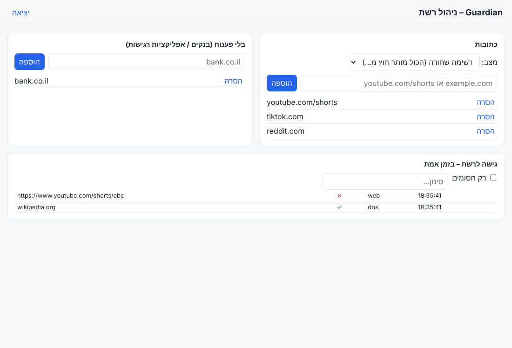

# Guardian – תוכנת שליטה וחסימה אישית לווינדוס

תוכנת self-control למחשב שלך: חסימת משתמשים לפי לו"ז, חסימת אפליקציות (כולל ניידות), וחומת אש/סינון אתרים.
כל ההגדרות מוצפנות ומוגנות בסיסמת ניהול, ויש **סיסמה מצילה** נפרדת שפותחת הכול (כולל הסרה).

## ארכיטקטורה

```
┌──────────────────────┐   named pipe (סיסמה)   ┌───────────────────────────────┐
│ guardian.exe (CLI)   │ ─────────────────────▶ │ שירות Windows (SYSTEM)        │
│ בהמשך: ממשק ניהול    │                        │ שם שירות רנדומלי/לבחירה       │
└──────────────────────┘                        │  • נעילת משתמשים (WTS logoff) │
                                                │  • חסימת exe (ETW/WMI + kill) │
                                                │  • חומת אש (Windows Firewall) │
                                                │  • DNS/Proxy מקומי לסינון URL │
                                                └──────────────┬────────────────┘
                                                               │ AES-256-GCM
                                                   ProgramData\GuardianData\config.bin
                                                   (מפתח עטוף ב-DPAPI LocalMachine)
```

* **C# / .NET 8**, קובץ exe יחיד self-contained. נבחר על פני Python כי יש גישה ישירה ל-Windows API
  (שירותים, WTS, Firewall COM, ETW) ואין צורך בהתקנת סביבה.
* `Guardian.Core` – לוגיקה טהורה ונבדקת: סיסמאות (PBKDF2-SHA256, 600k איטרציות), הצפנת קונפיג,
  לו"ז שבועי (כולל חלונות לילה), החלטות חסימת אפליקציות, התאמת דומיינים.
* `Guardian.Service` – השירות עצמו, התקנה/הסרה, ערוץ שליטה.

## הגנה מפני כיבוי/הסרה – מה זה עושה בפועל

* השירות רץ כ-SYSTEM, עולה אוטומטית, וה-SCM מפעיל אותו מחדש 5 שניות אחרי כל קריסה/הריגה.
* הרשאות השירות (DACL) מוסרות ממנהלים: `sc stop`, `services.msc` ו-`sc delete` נכשלים.
* הסרה מתבצעת רק דרך `guardian uninstall` – השירות עצמו בודק את הסיסמה ורק אז מסיר את ההגנה.
* 5 סיסמאות שגויות ⇒ נעילה ל-15 דקות.
* שם השירות רנדומלי וגנרי (למשל `NetSyncCore4821`) או לבחירתך.

### מגבלות אמיתיות (חשוב)

בווינדוס, **מנהל מערכת שמתעקש תמיד יכול לעקוף** תוכנה כזו (לקיחת בעלות, Safe Mode, עריכת registry
ממערכת אחרת, התקנה מחדש של ווינדוס). אין דרך לשנות זאת בלי driver חתום ברמת kernel, וגם זה ניתן לעקיפה.
התוכנה מעלה את הרף מספיק כדי לעצור דחפים רגעיים, לא אדם שמוכן להשקיע שעה.

**ההמלצה החזקה ביותר:** להשתמש ביומיום בחשבון **משתמש רגיל** (לא מנהל), ולתת את סיסמת חשבון המנהל
ואת הסיסמה המצילה לאדם אחר או לשמור אותן במקום שקשה לגשת אליו. בחשבון רגיל כל ההגנות כאן כמעט
בלתי עקיפות.

התוכנה **לא** מסתתרת ממנהל המשימות או מאנטי-וירוס – זה מכוון (טכניקות כאלה הן של נוזקות ויגרמו לאנטי-וירוס לחסום אותה).

## שלבים

| שלב | תוכן | מצב |
|---|---|---|
| 1 | שירות, סיסמת ניהול + מצילה, קונפיג מוצפן, הגנת DACL + restart, הסרה בסיסמה | ✅ |
| 2 | עריכת הגדרות דרך ה-CLI (ייבוא/ייצוא JSON בסיסמה) + טעינה חיה בשירות, החלפת סיסמאות | ✅ |
| 3 | נעילת משתמשים לפי לו"ז: התנתקות מאולצת + אזהרה מראש, חסימת כניסה דרך שעות הכניסה של החשבון, שחרור זמני בסיסמה | ✅ |
| 4 | חסימת אפליקציות: ניטור יצירת תהליכים (WMI) + סריקה, hash, default-deny ל-exe לא מוכר, לו"ז | ✅ |
| 5 | חומת אש לפי אפליקציה (Windows Firewall API) + סינון דומיינים (DNS מקומי + חסימת DoH) | ✅ |
| 6 | Proxy מקומי עם פענוח HTTPS (תעודת שורש מקומית) לסינון לפי כתובת מלאה, לוג גישה וממשק ניהול | ✅ |
| 7 | watchdog משני + מתקין | ⏳ |

הערה לשלב 4: חסימה ע"י הריגת תהליך מיד אחרי שעלה היא הדרך הסבירה בלי driver; היא מהירה (מילישניות) אך לא
מונעת הרצה של קוד שלב-אפס. אפשרות חזקה יותר היא **AppLocker / WDAC** (מובנה בווינדוס Pro/Enterprise) –
אפשר לשלב: השירות ייצר מדיניות AppLocker מההגדרות.


## בנייה ושימוש

```powershell
dotnet test
dotnet publish src/Guardian.Service -c Release -o publish
# כמנהל:
publish\guardian.exe install            # שם שירות רנדומלי
publish\guardian.exe install --name MySvc
guardian.exe status
guardian.exe uninstall                  # דורש סיסמת ניהול או מצילה
guardian.exe export policy.json         # ייצוא ההגדרות (בלי סיסמאות) לעריכה
guardian.exe import policy.json         # טעינת הגדרות; השירות מתעדכן תוך 5 שניות
guardian.exe set-password admin         # סיסמת ניהול או מצילה
guardian.exe set-password recovery      # רק הסיסמה המצילה
guardian.exe unlock Kids 60             # שחרור זמני של משתמש לשעה (סיסמת ניהול)
```

### נעילת משתמשים

* **שתי שכבות:** (1) "שעות כניסה" של חשבון ווינדוס – מסך הכניסה עצמו מסרב לכניסה בשעות נעולות מלאות;
  (2) לולאה כל 5 שניות ששולחת הודעת אזהרה X דקות לפני (`warningMinutes`) ומנתקת בדקה המדויקת.
* שעות כניסה עובדות על חשבונות מקומיים ועל חשבונות Microsoft שמחוברים למחשב. בחשבון דומיין (עבודה) רק הלולאה פועלת.
* **זהירות:** אם נועלים את *כל* החשבונות באותו זמן, אין דרך להיכנס למחשב עד שהחלון נגמר (הסיסמה המצילה לא עוזרת
  במסך הכניסה). השאירו תמיד חשבון אחד לא נעול, או חשבון מנהל נפרד שהסיסמה שלו אצל מישהו אחר.
* בהסרה, כל החשבונות מקבלים בחזרה גישה בכל השעות.

### חסימת אפליקציות

* כל exe שמתחיל נבדק (אירועי WMI של יצירת תהליך, ובנוסף סריקה כל 5 שניות). תהליך חסום נסגר יחד עם תהליכי הבן שלו,
  והמשתמש מקבל הודעה.
* **ברירת מחדל: חסימה.** מותר: `C:\Windows`, ו-`Program Files` (אם `trustProgramFiles` פעיל – רק מנהל יכול להתקין שם).
  כל השאר – קבצים ניידים מ-Downloads, שולחן העבודה, דיסק און קי, וגם תוכנות שמותקנות לתוך AppData
  (למשל Discord, Zoom, לפעמים Chrome/Teams) – חסום עד שמוסיפים כלל `Allow`.
* סדר עדיפות: כלל `Block` פעיל ⇐ חסום (גם בתוך Program Files); אחרת תיקייה מהימנה או כלל `Allow` ⇐ מותר; אחרת ברירת המחדל.
* התאמה לפי `sha256` (הכי חזק – עובד גם אם משנים שם או מעבירים קובץ; `guardian hash app.exe` מחשב אותו),
  `pathPrefix`, או `fileName` (הכי חלש). לכל כלל אפשר `when` עם לו"ז.
* מגבלה: בלי driver, התהליך קיים כמה מילישניות לפני שהוא נסגר. הוא לא מספיק לעשות משהו משמעותי, אבל זה לא מניעה
  מוחלטת. ל-Windows Pro אפשר להוסיף בעתיד יצירת מדיניות AppLocker מאותם כללים.

### חומת אש וסינון דומיינים

* **חסימה לפי אפליקציה:** כל נתיב ב-`network.blockedAppPaths` מקבל כלל חסימה יוצא ב-Windows Firewall (קבוצה "Guardian policy").
* **DNS מקומי** על `127.0.0.1:53` ו-`[::1]:53`. דומיין חסום מקבל `0.0.0.0`, והשאר נפתרים מול Cloudflare/Quad9 ב-DNS-over-HTTPS.
  `mode: Blocklist` – הרשימה חסומה; `mode: Allowlist` – רק הרשימה (+ כתובות שווינדוס צריך לעדכונים ולבדיקת חיבור) מותרת.
* **נגד עקיפה:** DNS של כל כרטיסי הרשת מכוון ל-DNS המקומי; חסימה של פורט 53/853 החוצה; כתובות DoH ציבוריות חסומות;
  policies ב-Chrome/Edge/Brave/Firefox מכבים DoH מובנה; חומת האש נשארת דלוקה. הכול נבדק ומוחזר כל 30 שניות.
* **נכשל-סגור:** אם השירות לא רץ, ה-DNS מצביע על כתובת מקומית שלא עונה ⇐ אין גלישה עד שהשירות עולה (ה-SCM מעלה אותו תוך 5 שניות).
* בהסרה: הכללים נמחקים, DNS חוזר ל-DHCP, וה-policies של הדפדפנים נמחקים.
* בלי `urlFiltering`, מי שמתחבר ישירות לכתובת IP או משתמש ב-VPN עוקף את סינון הדומיינים. עם `urlFiltering` (ברירת מחדל) זה נסגר – ראו למטה.

### סינון לפי כתובת מלאה (proxy מקומי) וממשק ניהול

* **proxy על `127.0.0.1:8899`** שמפענח HTTPS עם **תעודת שורש ייחודית למחשב** (נוצרת בהפעלה הראשונה, המפתח הפרטי מוצפן
  ב-DPAPI בתיקייה של SYSTEM, ורק התעודה הציבורית מותקנת ב-Trusted Root). כך אפשר לחסום `youtube.com/shorts` ולהשאיר את שאר יוטיוב.
* רשומה ב-`domains` יכולה להיות דומיין (`tiktok.com`) או תחילת כתובת (`youtube.com/shorts`, `google.com/search`).
  ב-DNS נחסמים רק דומיינים שלמים; כתובות עם נתיב נבדקות ב-proxy.
* תעודות האתרים האמיתיים **נבדקות כרגיל** – אתר עם תעודה לא תקינה מחזיר שגיאה 502 ולא "מוסתר" ע"י ה-proxy.
* `noDecryptDomains` – בנקים ואפליקציות עם certificate pinning: עוברים במנהרה בלי פענוח ומסוננים לפי דומיין בלבד.
* **נגד עקיפה:** ה-proxy מוגדר כ-proxy של כל המחשב (WinINET + WinHTTP), נעול לשינוי ע"י משתמשים; Firefox מכוון ל-proxy
  ולתעודות של ווינדוס דרך policy; וחומת האש עוברת ל**חסימת יציאה כברירת מחדל** – רק השירות עצמו, שירותי ווינדוס
  (svchost/System) ומה שב-`allowDirectApps` יוצאים ישירות. כך גם VPN, חיבור ישיר ל-IP ו-QUIC נחסמים.
* **השלכות שכדאי לדעת:** תוכנה שלא מכבדת את ה-proxy של המערכת (חלק מהמשחקים, Steam, Spotify, לקוחות VPN) לא תתחבר
  עד שמוסיפים אותה ל-`allowDirectApps`. אפליקציות Microsoft Store לא יכולות לגשת ל-127.0.0.1 כברירת מחדל ולכן עלולות לא להתחבר.
  כל בקשה פותחת חיבור חדש (keep-alive כבוי) – גלישה קצת איטית יותר. HTTP/2 ו-HTTP/3 לא בשימוש דרך ה-proxy (HTTP/1.1 בלבד).
* **ממשק ניהול:** `guardian ui` או http://127.0.0.1:8898 – כניסה בסיסמת ניהול, לוג גישה בזמן אמת (DNS + כתובות מלאות),
  הוספה/הסרה של כתובות, מעבר רשימה שחורה/לבנה. מוגן מפני אתרים אחרים (Host check, עוגייה SameSite=Strict, כותרת חובה).



תיקיית ההגדרות נעולה: SYSTEM בלבד יכול לכתוב, ולכן כל שינוי עובר דרך השירות שבודק סיסמה.

### דוגמת policy.json

```json
{
  "userLockouts": [
    { "userName": "Kids", "lockedDuring": { "windows": [
      { "days": ["Sunday","Monday","Tuesday","Wednesday","Thursday"], "start": "22:00", "end": "07:00" } ] },
      "warningMinutes": 5 }
  ],
  "apps": {
    "enabled": true, "defaultDeny": true,
    "rules": [
      { "action": "Allow", "pathPrefix": "C:\\Program Files\\Mozilla Firefox\\" },
      { "action": "Block", "fileName": "steam.exe",
        "when": { "windows": [ { "days": ["Monday"], "start": "08:00", "end": "16:00" } ] } }
    ]
  },
  "network": { "enabled": true, "mode": "Blocklist", "domains": ["example.com"], "blockedAppPaths": [] }
}
```
