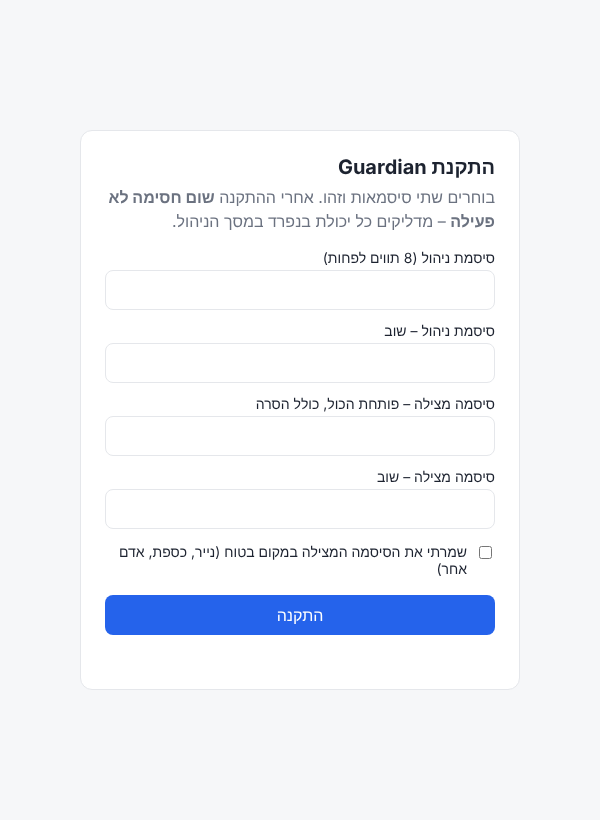

# Guardian – תוכנת שליטה וחסימה אישית לווינדוס

תוכנת self-control למחשב שלך: חסימת משתמשים לפי לו"ז, חסימת אפליקציות (כולל ניידות), וחומת אש/סינון אתרים.
כל ההגדרות מוצפנות ומוגנות בסיסמת ניהול, ויש **סיסמה מצילה** נפרדת שפותחת הכול (כולל הסרה).

## ארכיטקטורה

```
┌──────────────────────┐   named pipe (סיסמה)   ┌───────────────────────────────┐
│ guardian.exe (CLI)   │ ─────────────────────▶ │ שירות Windows (SYSTEM)        │
│ בהמשך: ממשק ניהול    │                        │ שם שירות רנדומלי/לבחירה       │
└──────────────────────┘                        │  • נעילת משתמשים (WTS logoff) │
                                                │  • חסימת exe (ETW/WMI + kill) │
                                                │  • חומת אש (Windows Firewall) │
                                                │  • DNS/Proxy מקומי לסינון URL │
                                                └──────────────┬────────────────┘
                                                               │ AES-256-GCM
                                                   ProgramData\GuardianData\config.bin
                                                   (מפתח עטוף ב-DPAPI LocalMachine)
```

* **C# / .NET 8**, קובץ exe יחיד self-contained. נבחר על פני Python כי יש גישה ישירה ל-Windows API
  (שירותים, WTS, Firewall COM, ETW) ואין צורך בהתקנת סביבה.
* `Guardian.Core` – לוגיקה טהורה ונבדקת: סיסמאות (PBKDF2-SHA256, 600k איטרציות), הצפנת קונפיג,
  לו"ז שבועי (כולל חלונות לילה), החלטות חסימת אפליקציות, התאמת דומיינים.
* `Guardian.Service` – השירות עצמו, התקנה/הסרה, ערוץ שליטה.

## הגנה מפני כיבוי/הסרה – מה זה עושה בפועל

* השירות רץ כ-SYSTEM, עולה אוטומטית, וה-SCM מפעיל אותו מחדש 5 שניות אחרי כל קריסה/הריגה.
* הרשאות השירות (DACL) מוסרות ממנהלים: `sc stop`, `services.msc` ו-`sc delete` נכשלים.
* הסרה מתבצעת רק דרך `guardian uninstall` – השירות עצמו בודק את הסיסמה ורק אז מסיר את ההגנה ומחזיר הכול לקדמותו:
  שעות כניסה, DNS, proxy, חומת אש, policies של דפדפנים, תעודת השורש, Safe Mode, ושני השירותים.
* **שני שירותים** עם שמות רנדומליים: הראשי ו-watchdog. כל אחד מפעיל מחדש את השני תוך 5 שניות אם נעצר.
* השירותים רשומים להפעלה גם ב-**Safe Mode** (רגיל ועם רשת), כך שאתחול ל-Safe Mode לא מבטל את החסימות.
* תיקיית ההתקנה ותיקיית ההגדרות: כתיבה ל-SYSTEM בלבד.
* 5 סיסמאות שגויות ⇒ נעילה ל-15 דקות.
* שם השירות רנדומלי וגנרי (למשל `NetSyncCore4821`) או לבחירתך.

### מגבלות אמיתיות (חשוב)

בווינדוס, **מנהל מערכת שמתעקש תמיד יכול לעקוף** תוכנה כזו (לקיחת בעלות על השירות והתיקיות, עריכת registry
מחוץ לווינדוס, אתחול מדיסק אחר, התקנה מחדש של ווינדוס). אין דרך לשנות זאת בלי driver חתום ברמת kernel, וגם זה ניתן לעקיפה.
התוכנה מעלה את הרף מספיק כדי לעצור דחפים רגעיים, לא אדם שמוכן להשקיע שעה.

**ההמלצה החזקה ביותר:** להשתמש ביומיום בחשבון **משתמש רגיל** (לא מנהל), ולתת את סיסמת חשבון המנהל
ואת הסיסמה המצילה לאדם אחר או לשמור אותן במקום שקשה לגשת אליו. בחשבון רגיל כל ההגנות כאן כמעט
בלתי עקיפות.

התוכנה **לא** מסתתרת ממנהל המשימות או מאנטי-וירוס – זה מכוון (טכניקות כאלה הן של נוזקות ויגרמו לאנטי-וירוס לחסום אותה).

## שלבים

| שלב | תוכן | מצב |
|---|---|---|
| 1 | שירות, סיסמת ניהול + מצילה, קונפיג מוצפן, הגנת DACL + restart, הסרה בסיסמה | ✅ |
| 2 | עריכת הגדרות דרך ה-CLI (ייבוא/ייצוא JSON בסיסמה) + טעינה חיה בשירות, החלפת סיסמאות | ✅ |
| 3 | נעילת משתמשים לפי לו"ז: התנתקות מאולצת + אזהרה מראש, חסימת כניסה דרך שעות הכניסה של החשבון, שחרור זמני בסיסמה | ✅ |
| 4 | חסימת אפליקציות: ניטור יצירת תהליכים (WMI) + סריקה, hash, default-deny ל-exe לא מוכר, לו"ז | ✅ |
| 5 | חומת אש לפי אפליקציה (Windows Firewall API) + סינון דומיינים (DNS מקומי + חסימת DoH) | ✅ |
| 6 | Proxy מקומי עם פענוח HTTPS (תעודת שורש מקומית) לסינון לפי כתובת מלאה, לוג גישה וממשק ניהול | ✅ |
| 7 | שירות watchdog משני, הפעלה גם ב-Safe Mode, נעילת תיקיית ההתקנה, הסרה מלאה | ✅ |
| 8 (v0.3) | חלון עצמאי (WebView2) במקום דפדפן, רשימת כל התוכנות במחשב עם נעילה/חסימת אינטרנט/גישה ישירה, מסך משתמשים ושעות, זיהוי תוכנות שעוקפות את המסנן (אירוע 5157), DNS יציב יותר (5 שרתים, מטמון), מסך חסימה בעברית, נעילת ממשק אחרי חוסר פעילות, פעולות לכל שורה בפעילות, עדכון גרסה ששומר הגדרות | ✅ |

הערה לשלב 4: חסימה ע"י הריגת תהליך מיד אחרי שעלה היא הדרך הסבירה בלי driver; היא מהירה (מילישניות) אך לא
מונעת הרצה של קוד שלב-אפס. אפשרות חזקה יותר היא **AppLocker / WDAC** (מובנה בווינדוס Pro/Enterprise) –
אפשר לשלב: השירות ייצר מדיניות AppLocker מההגדרות.


## התקנה

1. מורידים את `guardian.exe` ולוחצים עליו פעמיים (ווינדוס יבקש אישור מנהל).
2. נפתח חלון התקנה: בוחרים **סיסמת ניהול**, **סיסמה מצילה**, ואחרי כמה דקות ללא פעילות הממשק יינעל.
3. אחרי ההתקנה נפתח חלון הניהול (חלון עצמאי שמשתמש ב-WebView2 המובנה בווינדוס, כך שאפשר לחסום את הדפדפנים בלי לאבד את הממשק). **שום חסימה לא פעילה עדיין** – מדליקים כל יכולת בלשונית "יכולות", בודקים, וממשיכים.

מסך הניהול זמין תמיד מתפריט התחל ⇐ **Guardian**.

**עדכון גרסה:** מורידים את הגרסה החדשה ולוחצים עליה פעמיים. היא מזהה את הגרסה המותקנת, מבקשת סיסמת ניהול,
מסירה את הישנה ומתקינה את החדשה עם אותן הגדרות וסיסמאות.
הסרה: הגדרות ⇐ אפליקציות ⇐ Guardian ⇐ הסרה, ומזינים סיסמת ניהול או מצילה. ההסרה עובדת **גם אם השירות תקוע**:
אז הסיסמה נבדקת מקומית והניקוי רץ כ-SYSTEM דרך משימה מתוזמנת חד-פעמית.



## בנייה ושורת פקודה (למתקדמים)

```powershell
dotnet test
dotnet publish src/Guardian.Service -c Release -o publish
guardian.exe install [--name MySvc]     # התקנה בשורת פקודה
guardian.exe status
guardian.exe uninstall                  # סיסמת ניהול או מצילה
guardian.exe export policy.json         # ייצוא ההגדרות (בלי סיסמאות) לעריכה
guardian.exe import policy.json         # טעינת הגדרות; השירות מתעדכן תוך 5 שניות
guardian.exe set-password admin         # סיסמת ניהול או מצילה
guardian.exe set-password recovery      # רק הסיסמה המצילה
guardian.exe unlock Kids 60             # שחרור זמני של משתמש לשעה (סיסמת ניהול)
guardian.exe hash app.exe               # SHA-256 לכלל אפליקציה
```

תיקיית ההגדרות נעולה: SYSTEM בלבד יכול לכתוב, ולכן כל שינוי עובר דרך השירות שבודק סיסמה.

### דוגמת policy.json

```json
{
  "userLockouts": [
    { "userName": "Kids", "lockedDuring": { "windows": [
      { "days": ["Sunday","Monday","Tuesday","Wednesday","Thursday"], "start": "22:00", "end": "07:00" } ] },
      "warningMinutes": 5 }
  ],
  "apps": {
    "enabled": true, "defaultDeny": true,
    "rules": [
      { "action": "Allow", "pathPrefix": "C:\\Program Files\\Mozilla Firefox\\" },
      { "action": "Block", "fileName": "steam.exe",
        "when": { "windows": [ { "days": ["Monday"], "start": "08:00", "end": "16:00" } ] } }
    ]
  },
  "network": { "enabled": true, "mode": "Blocklist", "domains": ["example.com"], "blockedAppPaths": [] }
}
```
